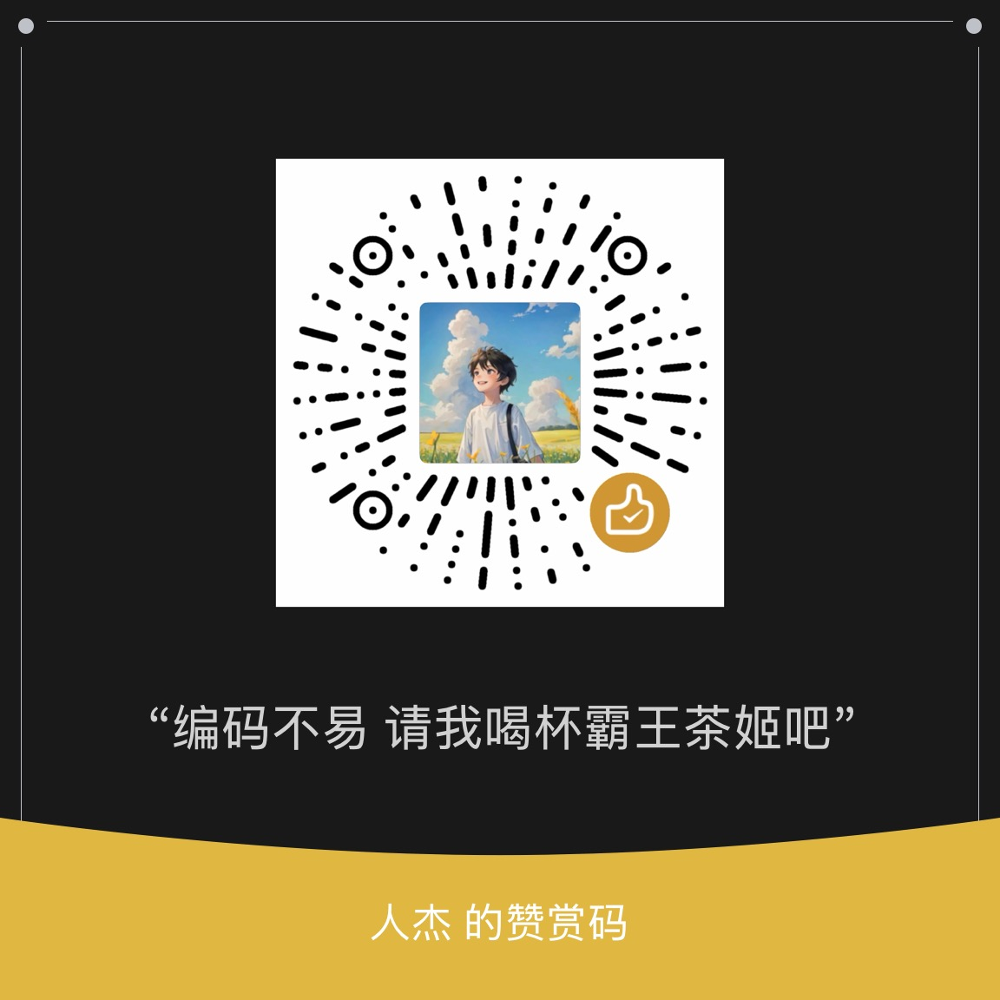

---

### 👋 关于我

- 🔧 全栈开发：**Node.js / Go** 后端为主，前端一把梭
- 📱 深耕**微信小程序**开发与逆向——懂协议，也懂调试
- 🧰 个人作品：**小程序调试工具** 等
- 🎯 信条：能自动化的绝不手动，好的工具自己会说话
- 📮 欢迎交流，好的 idea 比代码更值钱

### 🧰 技术栈

### 🚀 个人作品

| 作品 | 说明 |
| --- | --- |
| 🧰 **小程序调试工具** | 微信小程序开发调试利器 <!-- 有链接后补：[名称](链接) + 截图 --> |
| 🚧 更多作品 | 整理中… |

### 📊 GitHub 统计

<!-- vercel 公共实例（github-readme-stats）长期限流/不可达，两张卡先注释。
     想恢复：一键部署自己的免费实例（Deploy 按钮：https://vercel.com/new/clone?repository-url=https://github.com/anuraghazra/github-readme-stats），
     部署完成后把下面两个 URL 的域名换成你的 xxx.vercel.app 即可。

	
	

-->

	

<!-- 🐍 贪吃蛇动画：首次推送后在 Actions 手动跑一次 "generate snake"（或等每日定时），
     生成 output 分支后这里才会显示图片 -->
### 🐍 贡献贪吃蛇

<picture>
	<source media="(prefers-color-scheme: dark)" srcset="https://github.com/linguo2625469/linguo2625469/blob/output/github-contribution-grid-snake-dark.svg" />
	<source media="(prefers-color-scheme: light)" srcset="https://github.com/linguo2625469/linguo2625469/blob/output/github-contribution-grid-snake.svg" />
	
</picture>

### ☕ 赞赏

如果我的开源项目帮到了你，编码不易，可以请我喝杯霸王茶姬（完全自愿，谢谢支持 🙏）：

	

<!-- 微信长按 / 扫码即可赞赏；换图直接覆盖 assets/donate-wechat.jpg -->
